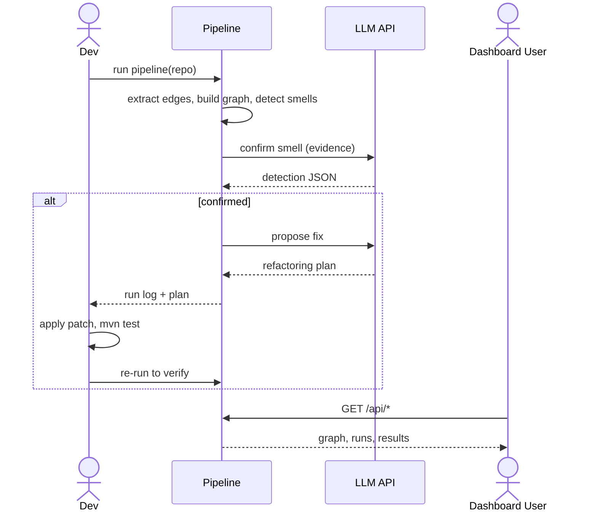

# Diagram Walkthrough

Companion to `PRESENTATION_PREP.md` — use this to talk through the two diagrams box-by-box
and arrow-by-arrow without losing the thread mid-presentation.

---

## 1. Architecture Diagram

**What this diagram is saying:** the system is a straight left-to-right pipeline (repo in,
findings + fixes out) with two things bolted on the side — an external LLM the pipeline
calls out to twice, and a dashboard that reads the results afterward without touching the
pipeline itself.

### The four groups (boxes with a dotted border)

A "group" here isn't a code module — it's a *zone of responsibility*, so faculty can see at
a glance which part of the system owns which concern.

| Group | What it represents |
|---|---|
| **Target Repo** | The thing being analyzed — someone else's microservices codebase |
| **Pipeline** | This project's own code — everything we built |
| **Storage** | Flat files on disk — no database, deliberately simple |
| **Backend** | The read/trigger layer the dashboard talks to |

### Every node, explained

| Node | What it actually is |
|---|---|
| **Source and Compose** | The Java source files and `docker-compose.yml` inside the target repo — raw input, untouched by us |
| **Extract and Detect Smells** | Stands in for four real modules: `pipeline/extractors/*.py` (pull out evidence) → `pipeline/graph_analysis.py` (build the dependency graph) → `pipeline/detectors/*.py` (the three smell detectors). Collapsed into one box here for readability |
| **LLM Detect and Refactor** | `pipeline/llm_detection.py` and `pipeline/llm_refactoring.py` — the two LLM calls per finding |
| **Logger** | `pipeline/run_logger.py` — writes every stage's input/output to disk |
| **LLM API** | The external NVIDIA-hosted, OpenAI-compatible endpoint. Drawn outside every group because it's not our code — a third-party dependency |
| **Manual Apply and Verify** | The one step that's still a human doing it by hand: apply the proposed patch, run `mvn test`, re-run the pipeline |
| **edges_current.json** | The extracted dependency graph, saved as a flat JSON file |
| **Run Logs** | One timestamped folder per run under `logs/runs/`, one JSON file per stage |
| **FastAPI** | `api/main.py` + `api/jobs.py` — reads the two storage nodes, and can also kick off new pipeline runs |
| **Dashboard** | The React frontend — what a person actually looks at |

### Every arrow, in the order you'd narrate it

1. **Source and Compose → Extract and Detect Smells** — the extractors read the target
   repo's Java files and compose file; nothing is written back to the repo.
2. **Extract and Detect Smells → edges_current.json** — the built dependency graph (post
   detection) is persisted to disk.
3. **edges_current.json → LLM Detect and Refactor** — each finding, with its supporting
   evidence, is handed to the LLM stage.
4. **LLM Detect and Refactor ↔ LLM API** (two arrows, detect and refactor) — the two
   outbound calls: "is this a real problem?" and "propose a fix." Both are request/response,
   which is why the arrow is bidirectional.
5. **LLM Detect and Refactor → Logger** — every prompt and every response gets logged,
   pass or fail.
6. **Logger → Run Logs** — the log directory is written to disk.
7. **LLM Detect and Refactor → Manual Apply and Verify** — the accepted refactoring plan is
   handed off; this is where automation currently stops.
8. **Manual Apply and Verify → Source and Compose** — the loop closes: once a human applies
   the fix, the *same* extractor is re-run against the now-modified repo to confirm the
   finding is gone. This is the one arrow that isn't automated end to end.
9. **edges_current.json / Run Logs → FastAPI** — the API layer is purely read-only over
   these two files; it does not re-derive anything the pipeline didn't already compute.
10. **FastAPI → Dashboard** — the dashboard renders whatever the API serves.

**One thing worth saying out loud to faculty:** arrow 8 is the only one that leaves the
automated system and comes back in — everything else is one continuous, unattended run.

---

## 2. Sequence Diagram

**What this diagram adds that the architecture diagram doesn't:** *time and decision order*
— who calls whom, in what sequence, and what happens only conditionally.

### The four lifelines

| Lifeline | Who/what this is |
|---|---|
| **Dev** | You, running `python -m pipeline.run_pipeline <repo>` (or clicking "Analyze" in the dashboard) |
| **Pipeline** | The whole `pipeline/` package, collapsed into one lifeline for readability — in reality this is acquisition → extraction → graph → detectors, all happening before the first LLM call |
| **LLM API** | The external NVIDIA endpoint — the only lifeline outside our own code |
| **Dashboard User** | A *second*, independent actor — someone browsing results afterward, who never triggers analysis themselves in this diagram |

### Every message, in order

1. **`Dev → Pipeline: run pipeline(repo)`** — the single entry point; one command, one
   repository URL or path.
2. **`Pipeline → Pipeline: extract edges, build graph, detect smells`** — a self-message,
   meaning this all happens internally with no external calls yet. This is
   deliberate: everything up to this point is deterministic and offline — no
   network, no API key required (`--no-llm` mode stops exactly here).
3. **`Pipeline → LLM: confirm smell (evidence)`** — the first LLM call. Note it only
   happens *after* a candidate finding already exists — the model is reacting to evidence,
   not searching for it.
4. **`LLM --> Pipeline: detection JSON`** — the structured verdict comes back
   (`detected`, `confidence`, `severity`, `rationale`).
5. **`alt confirmed` block** — this is the one branching point in the whole diagram. If the
   LLM says the finding is real *and* recommends a fix, the flow continues into refactoring;
   otherwise it stops here (that "otherwise" path is collapsed out of this compact version —
   it just logs the rejection and moves to the next finding).
6. **`Pipeline → LLM: propose fix`** / **`LLM --> Pipeline: refactoring plan`** — the second
   LLM call, only reached for confirmed findings.
7. **`Pipeline --> Dev: run log + plan`** — the developer gets back a concrete plan plus the
   full log trail, not just a verdict.
8. **`Dev → Dev: apply patch, mvn test`** — another self-message, marking that this step is
   *manual* — no arrow leaves the Dev lifeline to any automated component, because nothing
   automated exists for this step yet (this is the same gap as arrow 8 in the architecture
   diagram, seen from the time axis instead of the structure axis).
9. **`Dev → Pipeline: re-run to verify`** — closing the loop by hand: re-running the exact
   same entry point (step 1) against the now-patched repo.
10. **`Viewer → Pipeline: GET /api/*`** / **`Pipeline --> Viewer: graph, runs, results`** —
    a completely separate interaction. Note this can happen at any time, independent of
    whether an analysis is currently running — it's just reading whatever is already on
    disk.

**One thing worth saying out loud to faculty:** steps 8–9 are the only two messages in the
entire sequence that a human sends instead of the pipeline sending itself — that's a precise
way to point at exactly how much of the loop is *not yet* autonomous.

---

## Quick cross-reference

Both diagrams describe the same system from two angles — use whichever framing answers the
question being asked:

| If asked about... | Point to... |
|---|---|
| "What are the pieces and how do they connect?" | Architecture diagram |
| "What's the order of operations / when does the LLM get involved?" | Sequence diagram |
| "What's NOT automated yet?" | Arrow 8 (architecture) / steps 8–9 (sequence) — same gap, two views |
| "Does the dashboard trigger analysis or just show it?" | **Careful here — this compact diagram undersells it.** In reality the dashboard's `/analyze` page can also trigger a run (via `api/jobs.py`), not just read one; this diagram only draws the CLI path (`Dev → Pipeline`) and the read-only path (`Viewer → GET /api/*`) to keep the message count down. If asked, say the dashboard supports both, and this diagram simplifies that away. |
