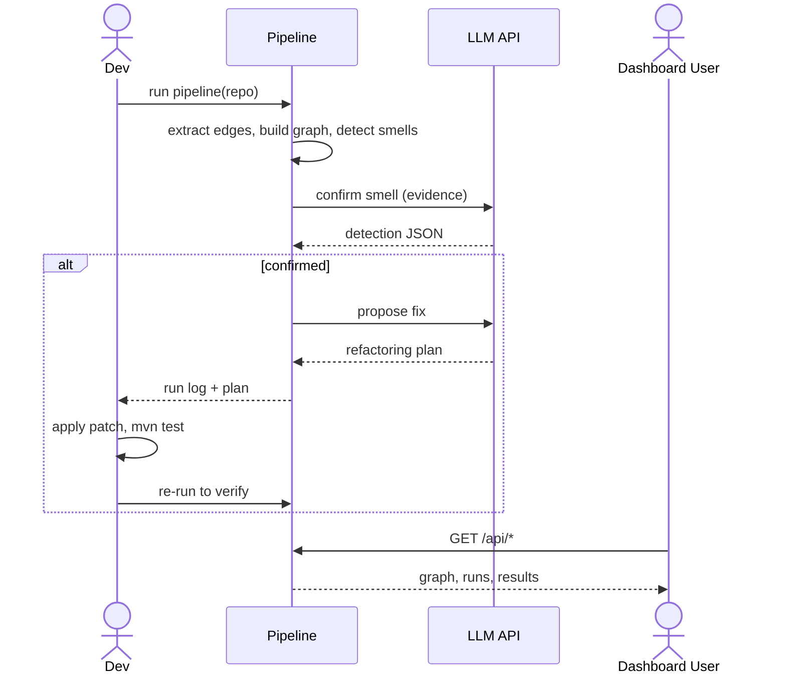

# Faculty Presentation Prep

## LLM-Guided Microservice Code Smell Detection & Autonomous Refactoring

Use this as your speaking notes / PPT source material. Every number and example below is
pulled from real test runs in this repo, not invented for the slide.

---

## 0. What this project actually is (30-second pitch)

A tool that points at a Java Spring Boot microservices repository — either the bundled
sample repo or **any public GitHub URL** — and:

1. **Finds architectural smells automatically**, using static analysis (no AI guessing):
   Cyclic Dependency, Hub-like Dependency, and Shared Persistence.
2. **Asks an LLM to judge each finding**, not to invent it — the model never gets to say
   "I found a smell," it only gets to say "yes, this static finding is a real problem,
   here's why" or "no, this doesn't matter here."
3. **Asks a second LLM call to propose a fix**, constrained so it can't touch files outside
   the services actually involved.
4. **Logs everything** — every prompt, every response, every stage — so any run can be
   reproduced and audited later.
5. Has a **dashboard** where you pick a repo, pick which smells to check, and watch the
   analysis run stage by stage.

The one thing it does **not** do yet: apply the fix to the code automatically. That's the
one remaining manual step (see §5, §7).

---

## 1. System Architecture and Detailed Design

High-level flow — repository in, findings + fix proposals out, everything logged:


**How a single run actually moves through the system:**



**Design decisions worth mentioning to faculty:**
- **Static analysis first, LLM second.** The LLM is never the detector — it's a judge given
  evidence a deterministic algorithm already produced. This keeps the system's core claims
  falsifiable and reproducible; the LLM's non-determinism only affects *explanation and
  judgment*, never *what counts as a candidate*.
- **Every stage is independently testable and independently loggable.** No stage's failure
  silently corrupts another's output — errors are caught and recorded per finding, per
  detector, so one bad LLM response doesn't kill the whole run.
- **Repository-agnostic by design.** Nothing in the pipeline hardcodes the bundled sample
  repo; it was tested against several real, unrelated GitHub repositories during
  development (evidence: `logs/runs/` contains multiple teammates' runs against different
  external repos).

---

## 2. Description of the Implemented Modules

| Module | Responsibility |
|---|---|
| `pipeline/repository.py` | Takes a Git URL or local path; clones into a scratch `workspace/` directory (or uses the local checkout), cleaned up after the run |
| `pipeline/extractors/rest.py` | Finds service-to-service call evidence: `@FeignClient`, `DiscoveryClient.getInstances(...)`, `RestTemplate`/`WebClient` calls. Recognizes both **Maven** (`pom.xml`) and **Gradle** (`build.gradle`/`.kts`) service modules |
| `pipeline/extractors/docker.py` | Reads `docker-compose.yml` `depends_on` blocks (kept separate — startup order, not call coupling) |
| `pipeline/extractors/persistence.py` | Finds datasource config, JPA `@Table` declarations, and SQL schema/migration files, for Shared Persistence evidence |
| `pipeline/graph_analysis.py` | Builds a `networkx.DiGraph` of real call edges; canonicalizes cycles so results are deterministic across runs |
| `pipeline/detectors/cyclic_dependency.py` | Cycle detection over the graph |
| `pipeline/detectors/hub_dependency.py` | Statistical hub detection (see §3) |
| `pipeline/detectors/shared_persistence.py` | Database-identity / table-overlap detection |
| `pipeline/llm_detection.py` | One LLM call per finding, grounded in real code evidence, requesting structured JSON with a repair/retry loop for malformed output |
| `pipeline/llm_refactoring.py` | Second LLM call proposing a minimal fix, with a scope-enforcement check (see §3) |
| `pipeline/run_logger.py` | Writes one timestamped, per-stage JSON log directory per run |
| `pipeline/run_pipeline.py` | Orchestrates all of the above in one command; contains **no smell-specific logic** itself |
| `api/main.py` + `api/jobs.py` | FastAPI backend: reads logs, and starts new pipeline runs from the dashboard on a background thread |
| `frontend/` | Vite + React + TypeScript dashboard: pick a repo/smells, watch live progress, browse findings/fixes/graph/history |
| `tests/` | 220-test pytest suite, fully offline (LLM calls and `git clone` are mocked) |

---

## 3. Methodology and Algorithms Employed

### 3.1 Overall pipeline algorithm

```
R ← Acquire(repo)
EB ← Extract(R)
G ← BuildGraph(EB.callEdges excluding compose)

F ← ∅
for each smell s in S:
  F ← F ∪ Detect[s](G, EB)

for each finding f in F:
  ev ← Evidence(f, EB)
  d ← LLMDetect(f, ev); log(d)
  if d.detected and d.refactoring_recommended:
    for attempt in 1..max_retries:
      p ← LLMRefactor(f, ev, d)
      if all files(p) in services(f): accept; break
      else: re-prompt with the offending paths
    log(p)
return findings, plans, logs
```

`max_retries = 3` for both the scope-enforcement loop and the JSON-repair loop
(`pipeline/config.py: max_json_retries`).

### 3.2 Per-smell detection algorithm

- **Cyclic Dependency** — `networkx.simple_cycles()` on the directed service-call graph.
  Cycles are canonicalized (rotated to start at the lexicographically smallest node) so the
  same graph always yields byte-identical output, regardless of traversal order.
- **Hub-like Dependency** — a service is flagged only if it clears **both**:
  - an absolute floor (`min_degree = 4` — small graphs can't produce spurious hubs), **and**
  - a statistical-outlier test (`degree ≥ mean + 1.5 × stdev` of the graph's own degree
    distribution) **or** a connectivity-share test (`degree ≥ 0.5 ×` the number of other
    services).
  This means "hub" is relative to *this specific graph's own shape*, not a fixed number —
  a service with degree 5 is a hub in a 6-node graph but not necessarily in a 40-node one.
- **Shared Persistence** — services are grouped by resolved database *identity*
  (`scheme://host:port/database`, e.g. `mysql://bookstore-mysql-db:3306/bookstore_db`); any
  identity shared by ≥2 services is a finding. Table-name overlap is a weaker, opt-in
  secondary signal. In-memory drivers (H2, HSQLDB, Derby, SQLite) are never reported — every
  service naturally has "its own" in-memory instance.

### 3.3 Two-stage LLM methodology

The LLM never searches for smells. It receives a **pre-built candidate** — the finding, the
real evidence lines, and the smell's definition — and is asked to return structured JSON:
`detected`, `confidence`, `severity`, `rationale`, `refactoring_recommended`. This verdict
is stored **alongside**, never in place of, the deterministic severity/confidence — both are
kept so the model's judgment can be evaluated against the static signal.

### 3.4 Scope enforcement (the safety gate on refactoring)

The refactoring agent's proposal is only accepted if every file it names belongs to a
service actually implicated in the finding. If not, the specific offending paths are fed
back to the model and it is re-prompted (bounded by `max_retries`) — the plan is never
silently accepted *or* silently dropped.

---

## 4. Implementation Progress

| Step | What | Status |
|---|---|---|
| 1 | Select & verify target repo | ✅ Done |
| 2 | Dependency extractor | ✅ Done — generalized (Maven + Gradle, REST + compose + persistence) |
| 3 | Graph + cycle detection | ✅ Done — cycles canonicalized |
| 4 | LLM Detection Agent | ✅ Done — generalized to any smell |
| 5 | LLM Refactoring Agent | ✅ Done — generalized to any smell |
| 6 | Manual apply & verify | ❌ **Not started — still manual** |
| 7 | Per-run logging | ✅ Done |
| — | Repository acquisition (Git URL / local path) | ✅ Done |
| — | Pipeline orchestrator (single command) | ✅ Done |
| — | Hub-like Dependency detector | ✅ Done |
| — | Shared Persistence detector | ✅ Done (beyond original PRD scope) |
| — | Dashboard (starts + visualizes runs) | ✅ Done |

---

## 5. Preliminary Results, Testing, and Validation

**Automated test suite:** `python -m pytest tests/ -q` → **220 tests passing**, fully
offline (every LLM call and every `git clone` is mocked, so results don't depend on network
or API-key availability).

**Real detector output — three concrete examples, two different repositories:**

1. **Cyclic Dependency** (bundled `target-repo`, synthetic fixture between
   `customers-service` and `visits-service`) — LLM-confirmed: `detected: true`,
   `confidence: 0.95`, `severity: HIGH`. Refactoring agent proposed removing
   `customers-service`'s call into `visits-service`
   (`VisitsServiceClient.getVisitCount`) as the minimal cycle-breaking change.

2. **Hub-like Dependency** (real external repo,
   `devdcores/BookStoreApp-Distributed-Application` on GitHub) — `bookstore-feign` flagged:
   directly connected to **5 of 5** other services (0 inbound, 5 outbound) against a graph
   mean degree of 1.67 — both the statistical-outlier test and the connectivity-share test
   triggered. `severity: HIGH`, `confidence: 0.95`.

3. **Shared Persistence** (same repo) — 5 services (`account`, `billing`, `catalog`,
   `order`, `payment`) all resolved to the identical database identity
   `mysql://bookstore-mysql-db:3306/bookstore_db`. `severity: MEDIUM`, `confidence: 0.9`
   (medium, not high, because no overlapping table declarations were also observed — the
   detector distinguishes "same database" from "provably same tables").

**What this demonstrates:** the pipeline runs unmodified against a repository it has never
seen before (pulled live from GitHub, not the bundled fixture) and produces specific,
evidence-backed findings with file/line citations — not generic warnings.

---

## 6. Challenges Encountered and Proposed Solutions

| Challenge | Solution / mitigation |
|---|---|
| **LLM sometimes returns malformed JSON.** | A JSON-repair/retry loop (`max_json_retries = 3`) — treated as expected LLM behavior to plan around, not a system failure. |
| **Cycle detection was non-deterministic** (`nx.simple_cycles` returns a cycle starting at whichever node it hit first, so the same graph could print `A→B→A` one run and `B→A→B` the next). | Fixed by canonicalizing every cycle to start at its lexicographically smallest node before comparing/logging. |
| **"Hub" has no universal threshold** — a fixed degree cutoff is either too strict for small graphs or too loose for large ones. | Combined an absolute floor with a statistical-outlier test computed from *that graph's own* degree distribution, so the threshold scales with the repo being analyzed. |
| **Refactoring proposals could hallucinate changes outside the smell's actual scope.** | A scope-enforcement check rejects and re-prompts (bounded retries) with the specific offending file paths, rather than silently accepting or dropping an out-of-scope plan. |
| **Claude API access wasn't readily available during development.** | Switched to NVIDIA's OpenAI-compatible hosted endpoint for both LLM stages — a documented provider swap; nothing downstream depends on which provider sits behind the `call_llm()` call. |
| **The system only sees REST calls** — gRPC and message-queue (Kafka/RabbitMQ/JMS) communication is invisible to a regex-based extractor. | Documented as an explicit, stated scope boundary (not a bug) — the extractor is regex/string-matching by design, not AST-based, per the project's own scoping. |
| **Step 6 (apply the fix, re-test, re-verify) is still a manual human action.** | Scoped deliberately for Phase 1 as the final accept/reject gate — see §7 for the automation plan. |

---

## 7. Work Completed and Plan for the Remaining Implementation

**Completed (Phase 1 core + generalized well past it):**
- End-to-end pipeline: acquisition → extraction → 3 detectors → LLM validation → LLM
  refactoring proposal → logging, in one command, against any Git URL or local repo.
- Interactive dashboard that starts and visualizes runs, not just displays static output.
- 220-test offline suite covering every module.

**Remaining, in priority order:**
1. **Automate Step 6** — apply a proposed refactoring plan to a branch, run `mvn test`,
   re-run the pipeline, and confirm the finding disappeared. This closes the loop end to end
   and is the single biggest remaining gap.
2. **Evaluation corpus** — run the pipeline across several repositories and label the
   findings (precision/recall per smell) — this is what the thesis's measurement chapter
   needs; currently the pipeline works but hasn't been formally scored against ground truth.
3. **Further Phase 2+ items** (not yet started): a RAG layer for services too large for one
   prompt, LangGraph orchestration with bounded retries, cross-validation against
   established tools (Arcan / MSANose / DesigniteJava), EvoSuite regression-test generation,
   and MLflow experiment tracking with Scott-Knott ESD statistical comparison across
   repos/baselines.

**Guiding principle throughout** (stated explicitly in the project's own build plan):
*working end-to-end prototype → reproducible experiment → measurable results → then add
complexity.* Nothing above the current line was added before the Phase 1 loop was
demonstrably working.
